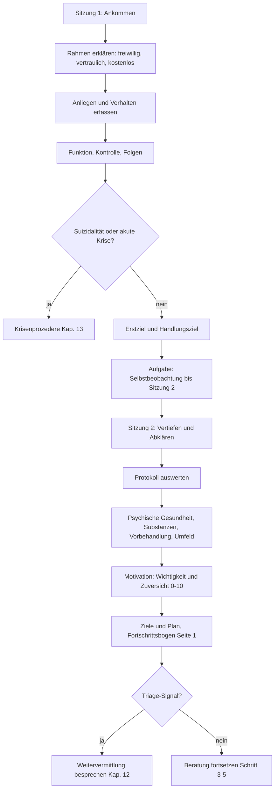
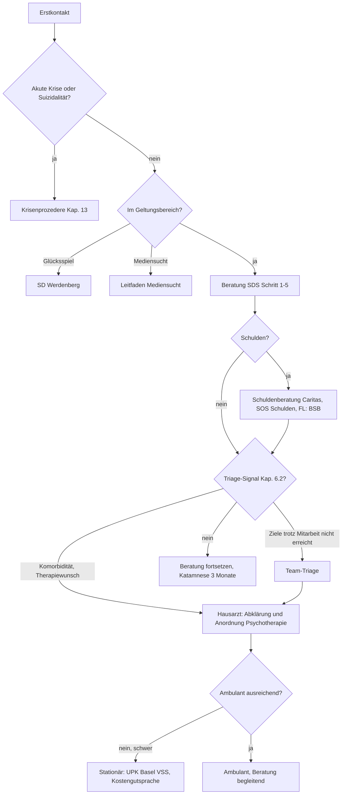

# Beratungsleitfaden Verhaltenssüchte

Fachstelle Sucht, Soziale Dienste Sarganserland (SDS) · Entwurf 0.1 · Stand 21.10.2026

Dieser Leitfaden ist ein Entwurf zur Besprechung im Team. Er stützt sich auf die Recherche vom 21.10.2026 und ergänzt sie um eine Triage-Recherche. Alle Aussagen tragen einen Marker (Kap. 0.4). Vor dem Einsatz sind die als [Lücke] oder [Vorschlag] markierten Punkte im Team zu klären.

---

## 0. Zweck, Geltungsbereich, Nutzung

### 0.1 Zweck

Der Leitfaden gibt Beratenden Sicherheit in der Arbeit mit Verhaltenssüchten. Er zeigt den bio-psycho-sozialen Kontext der Klientinnen und Klienten, erleichtert die Psychoedukation und ermöglicht Beratungen auf hohem fachlichem Niveau. Er ist ein Gerüst aus Bausteinen, kein starres Programm (anders als das Konzept ambulanter Alkoholentzug, dessen Form er übernimmt).

### 0.2 Geltungsbereich

| Punkt | Festlegung |
|---|---|
| Zielgruppe | Volljährige Einwohnerinnen und Einwohner des Einzugsgebiets SDS und des Fürstentums Liechtenstein (FL) |
| Adressaten des Angebots | Betroffene, Angehörige, Arbeitgebende, Ausbildende. Das Angebot ist kostenlos |
| Einbezogene Verhaltenssüchte | Kaufsucht, Arbeitssucht, Sex- und Pornografiesucht, Sportsucht (mit Hinweis Muskeldysmorphie), weitere Formen |
| Ausgeschlossen | Glücksspiel (Beratung für Sarganserland durch die SD Werdenberg), Computerspiel-, Internet- und Mediensucht (eigener Leitfaden) |
| Abgrenzung | Keine psychotherapeutische Behandlung (Kap. 6.2) |
| Grenzfall | Pornografie ist meist online, gehört fachlich aber zur zwanghaften Sexualverhaltensstörung. Sie wird hier behandelt, mit Verweis auf den Mediensucht-Leitfaden für Social Media, Gaming, Streaming [Vorschlag] |

### 0.3 Persona und Stakeholder

**Persona Beratende:** Sozialarbeitende mit Erfahrung im Suchtbereich. Beratung zu den regulären Öffnungszeiten. Enge Kooperation mit Dritten ist ausdrücklich gewünscht (Hausärztinnen und Hausärzte, psychiatrische Institutionen, Kliniken, Spitäler, Spitex, Pro Infirmis, andere Fachstellen). Regelmässiger Austausch mit anderen Suchtberatungsstellen. Intervision, Fallbesprechungen und Einzelsupervision gehören zum Alltag. Der Leitfaden richtet sich auch an neue Mitarbeitende und Personen in Ausbildung.

| Stakeholder | Was sie brauchen | Kapitel |
|---|---|---|
| Betroffene | Entlastung vom Stigma, verständliche erste Schritte, Orientierung zum Weg | 3, 9, 14 (Anhang) |
| Angehörige | Belastung einordnen, nicht-konfrontativ handeln, eigene Grenzen, finanzielle Verflechtung | 10 |
| Arbeitgebende, Ausbildende | Auffälligkeiten erkennen, Gesprächsführung, Rolle und Grenzen | 11 |
| Beratende (neu und erfahren) | Abfrageschema, Techniken, Grenze zur Psychotherapie, Triage | 6, 7, 8, 12 |
| Kooperationspartner | Klare Überweisungskriterien, Einwilligung, Rückmeldung | 12 |
| Träger (SDS) und Region (SG, FL) | Zuständigkeit, Kosten, Abgrenzung zu Glücksspiel und Medien | 0, 12 |

Grafik G6 (Stakeholder-Karte): siehe Kap. 14.

### 0.4 Marker im Text

| Marker | Bedeutung |
|---|---|
| (Q: Name) | In einer recherchierten Quelle belegt, in eigenen Worten wiedergegeben. Quellen: Kap. 15 |
| [Vorschlag] | Gestaltungsvorschlag, kein Beleg, Entscheid beim Team |
| [eigenes Wissen] | Fachlich geläufig, nicht durch Quelle geprüft, vor Verwendung verifizieren |
| [Lücke] | Nicht recherchiert oder nicht auffindbar |

### 0.5 Aufbau und Grafiken

Kap. 1–5 Grundlagen · Kap. 6–8 Beratung, Abfrage, Ziele · Kap. 9–11 erste Schritte und weitere Adressaten · Kap. 12 Triage · Kap. 13 Krisen · Kap. 14 Grafiken und Anhang · Kap. 15 Quellen · Kap. 16 offene Punkte.

---

## 1. Was ist eine Verhaltenssucht?

### 1.1 Arbeitsdefinition

Exzessiv betriebene, zwanghaft wiederholte Verhaltensweisen mit unwiderstehlichem Drang, gedanklicher Vereinnahmung, Kontrollverlust über Beginn, Häufigkeit, Intensität, Dauer und Beendigung, Fortführung trotz negativer Folgen und starker Beeinträchtigung in verschiedenen Lebensbereichen (Q: Ärzteblatt).

Zwei Unterscheidungen sind für die Beratung zentral:

- **Viel ist nicht gleich krankhaft.** Entscheidend sind Kontrollverlust, Leidensdruck und Beeinträchtigung über längere Zeit, nicht die Menge (Q: therapie.de; aponet).
- **Beratende diagnostizieren nicht.** Sie erfassen systematisch, was vorliegt, und weisen zu (Kap. 12).

### 1.2 Klassifikation: ICD-10 und ICD-11

| Verhalten | ICD-10 | ICD-11 | Beleg |
|---|---|---|---|
| Glücksspiel (ausgeschlossen, zur Abgrenzung) | F63.0 | 6C50, Störung durch Suchtverhalten | Q: Rosenfluh; Rumpf/Brandt |
| Gaming (ausgeschlossen, zur Abgrenzung) | keine eigene | 6C51, Störung durch Suchtverhalten | Q: Rumpf/Brandt; Sozialministerium AT |
| Zwanghaftes Sexualverhalten (CSBD) | keine eigene Kategorie | 6C72, bei den Impulskontrollstörungen | Q: therapie.de; PornLoS-Artikel |
| Pornografie-Nutzungsstörung | – | Variante der CSBD (6C72). Daneben als „andere näher bezeichnete Störung durch Suchtverhalten" vorgeschlagen | Q: Thieme PornLoS; Rumpf/Brandt |
| Kaufsucht | F63.8 oder F63.9 (Impulskontrolle) | keine eigene Kategorie. Als „andere näher bezeichnete Störung durch Suchtverhalten" vorgeschlagen, Einordnung debattiert | Q: Thieme „Kaufsucht"; Rumpf/Brandt |
| Arbeits- und Sportsucht | keine eigene Kategorie (allgemein F63.9) | keine eigene Kategorie | Q: Sozialministerium AT; Rosenfluh |

**Kernaussagen zur Abgrenzung**

- ICD-10 fasst Verhaltenssüchte weitgehend unter F63 (abnorme Gewohnheiten und Impulskontrolle) (Q: Sozialministerium AT).
- ICD-11 kennt als Verhaltenssüchte im engeren Sinn nur Gambling und Gaming Disorder. Kernmerkmale: Kontrollverlust, Priorität im Leben, Fortsetzung trotz negativer Folgen, dazu funktionale Beeinträchtigung (Q: Rumpf/Brandt). Üblicher Zeitrahmen 12 Monate, bei schwerer Ausprägung kürzer [eigenes Wissen].
- Andere Formen sind als „andere näher bezeichnete Störungen durch Suchtverhalten" kodierbar. Kauf-/Shoppingstörung und Pornografie-Nutzungsstörung gelten als geeignete Kandidaten (Q: Rumpf/Brandt).
- Die Sechs-Kriterien-Regel (3 aus 6) stammt aus dem ICD-10-Abhängigkeitssyndrom für Substanzen. Für Verhaltenssüchte gilt sie nur als Analogie.
- Die Aufnahme in eine Klassifikation ändert die Finanzierung nicht. Leistungen sind vergütbar, wenn die Erkrankung medizinisch behandlungsbedürftig ist (Q: NZZ am Sonntag 2019).
- Welche Klassifikation in der Schweiz aktuell für Kodierung und Abrechnung gilt, ist nicht geprüft [Lücke].

Grafik G1 (Landkarte der Verhaltenssüchte mit ICD-Zuordnung): siehe Kap. 14.

---

## 2. Welche Verhaltenssüchte gibt es?

### 2.1 Übersicht

| Kategorie | Formen | Im Leitfaden |
|---|---|---|
| ICD-11 klassifiziert | Glücksspiel, Gaming | ausgeschlossen |
| ICD-11, anderer Bereich | Zwanghaftes Sexualverhalten (inkl. Pornografie) | Steckbrief 2.4 |
| Diskutiert, „andere näher bezeichnete" | Kaufsucht | Steckbrief 2.2 |
| Ohne eigene Kategorie, praxisrelevant | Arbeitssucht, Sportsucht | Steckbriefe 2.3, 2.5 |
| Weitere | Beziehungssucht, Sammeln/Horten; Social Media, Streaming, Smartphone (Mediensucht, ausgeschlossen) | Kurzmodul 2.6 |

Fachverband Sucht nennt in einem Kursangebot: Glücksspiel, Internet/Medien, Kaufsucht, Sexsucht, Bewegungssucht, Arbeitssucht (Q: Fachverband Sucht).

**Häufigkeit (Deutschland, Richtwerte):** Glücksspiel ca. 1 %, Internetspiele ca. 1 %, Kaufsucht ca. 5 % (Q: Ärzteblatt 2020); Kaufsuchtgefährdung 5–7 % der Erwachsenen (Q: Thieme „Kaufsucht"). Frauen sind häufiger von Kaufsucht betroffen, Männer eher von Glücksspiel und Sexsucht (Q: Psychosomatik-Studie). Schweizer Zahlen: [Lücke].

### 2.2 Steckbrief Kaufsucht

| Aspekt | Inhalt |
|---|---|
| Kern | Kurzfristige Kompensation unangenehmer Gefühle. Negative Folgen (Schulden) treten verzögert auf und wirken nicht unmittelbar bestrafend (Q: Ärzteblatt) |
| Klassifikation | F63.8/F63.9, ICD-11 keine eigene Kategorie (Kap. 1.2) |
| Typische Äusserung | Kaufdrang, Käufe über Bedarf, Verstecken von Waren, Retouren, mehrere Karten und Kredite, Verheimlichen (Q: Ärzteblatt) |
| Folgen | Verschuldung, Partnerschaftskonflikte, Scham, Suizidrisiko (Kap. 5) |
| Beratungsakzente | Primär/sekundär abklären (Komorbidität). Auslöser meiden (Läden, Portale, Marken), Karten und Limiten, Wartezeit vor Käufen, Schuldenmanagement. Ziel in der Regel „bedarfsgerechtes Kaufen", nicht Totalverzicht (Q: Ärzteblatt) |
| Zusatzfragen | Ausgaben pro Woche, Kreditkarten, Retouren, Verstecken von Waren, Schulden, gemeinsame Konten |
| Screener | BSAS, PBS (Kap. 8.6) |
| Wirksamkeit | Keine evidenzbasierten Leitlinien, Hinweise auf Wirksamkeit störungsspezifischer KVT-Gruppentherapie (Q: Thieme „Kaufsucht"; Mueller/de Zwaan 2008) |

### 2.3 Steckbrief Arbeitssucht

| Aspekt | Inhalt |
|---|---|
| Kern | Klassische Suchtkriterien (Kontrollverlust, Dosissteigerung, Entzugserscheinungen) als Orientierung. Grenze zwischen Arbeit und Freizeit verschwimmt, auch durch ständige Erreichbarkeit (Q: AOK; Poppelreuter 2006) |
| Klassifikation | keine eigene Kategorie |
| Abgrenzung | Hochleistung und hohe Arbeitsbelastung sind nicht automatisch Sucht. Entscheidend: Kontrollverlust, Leidensdruck, Folgen |
| Beratungsakzente | Arbeitgebende als Ressource: Strukturen, die Arbeitssucht erschweren (Q: Basel Arbeitgeberberatung). Erholung, Erreichbarkeit, Wochenstruktur |
| Zusatzfragen | Wochenstunden, Erreichbarkeit, Erholung, Urlaub, Reaktion der Umgebung, Schlaf |
| Besonderheit | Leistungsmuster: Zahlen und Ziele dürfen nicht zum Wettbewerb werden (Kap. 8.7) |
| Screener | Work-BAT, Bergen Work Addiction Scale [eigenes Wissen, nicht recherchiert] |

### 2.4 Steckbrief Sex- und Pornografiesucht (CSBD)

| Aspekt | Inhalt |
|---|---|
| Kern | Anhaltendes Muster gescheiterter Kontrolle intensiver sexueller Impulse, Fortführung trotz negativer Folgen. Entscheidend: Kontrollverlust, Leidensdruck und Beeinträchtigung über längere Zeit (ICD-11: mindestens ca. 6 Monate) (Q: therapie.de; aponet) |
| Klassifikation | 6C72, Impulskontrollstörungen. Pornografie-Nutzungsstörung als Variante (Kap. 1.2) |
| Typische Äusserung | Am häufigsten exzessives Masturbieren und häufige Pornografienutzung (Q: therapie.de; aponet) |
| Stigma | Besonders stark (Kap. 3) |
| Beratungsakzente | MI, funktionale Verhaltensanalyse, KVT-Elemente beschrieben (Q: Hughes; Del Giudice/Kutinsky). Komorbiditäten werden durch die Verhaltensanalyse oft entdeckt (Q: Hughes). Filter und Blocker als Stimuluskontrolle [Vorschlag] |
| Zusatzfragen | Zeit, Beziehungsfolgen, Risikoverhalten, Illegales, Heimlichkeit |
| Wirksamkeit | Für Pornografie-Nutzungsstörung fehlen bisher methodisch hochwertige Therapiestudien; ein Manual (PornLoS) erscheint laut Verlag 2026 (Q: Thieme PornLoS; Hogrefe) |
| Screener | CSBD-19 (Kurzform CSBD-7), PPCS-6 (Kap. 8.6) |

### 2.5 Steckbrief Sportsucht

| Aspekt | Inhalt |
|---|---|
| Kern | Zwanghaftes Training trotz Schmerzen oder Verletzung (Q: Ärzteblatt; Fachverband Sucht: Bewegungssucht) |
| Klassifikation | keine eigene Kategorie |
| Besonderheit Muskeldysmorphie | Verzerrte Wahrnehmung der eigenen Muskulatur. Der Gebrauch von Anabolika macht das Bild substanzgebunden (Auftrag). Beratende fragen nach Substanzen und leiten bei Gesundheitsrisiko an ärztliche Abklärung weiter [Vorschlag] |
| Beratungsakzente | Beratungsmaterial zur Sportsucht ist nicht recherchiert [Lücke]. Als Ausgangspunkt dienen die allgemeinen Bausteine (Kap. 6.4) mit Fokus auf Verletzungen, Erholung, Ernährung |
| Zusatzfragen | Schmerzen, Verletzungen, Trainingsumfang, Ersatz fürs Training, Anabolika oder Nahrungsergänzung, Essverhalten |
| Besonderheit | Leistungsmuster: Kap. 8.7 |
| Screener | Exercise Addiction Inventory [eigenes Wissen, nicht recherchiert] |

### 2.6 Kurzmodul weitere Formen [Vorschlag]

Beziehungssucht, Sammeln und Horten. Horten ist als Komorbidität zur Kaufsucht beschrieben (Q: Ärzteblatt). Für diese Formen gilt: Funktion des Verhaltens erfassen, Leidensdruck und Beeinträchtigung prüfen, Komorbidität erfragen, bei Bedarf zuweisen. Materialien zu diesen Formen sind nicht recherchiert [Lücke].

---

## 3. Stigma und Scham

### 3.1 Befund

- Verhaltenssüchte werden wegen Scham häufig verschwiegen und sind unterdiagnostiziert (Q: Ärzteblatt).
- Typisch sind Bagatellisieren, Verheimlichen und schneller Rückzug bei Vorwürfen. Das ist Teil des Bildes, kein Widerstand gegen die Beratung (Q: Ärzteblatt).
- Das Selbstkonzept ist oft durch unerreichte Idealvorstellungen geprägt. Wertschätzende Reflexion gehört zur Behandlung (Q: Ärzteblatt; Gauls).
- Bei Sexualverhalten ist die Abgrenzung zwischen normal und krankhaft schwierig. Starkes Verlangen ist nicht automatisch eine Störung (Q: therapie.de; aponet).
- Die Aufnahme ins ICD-11 soll laut Fachliteratur Stigma reduzieren und Behandlung verbessern (Q: Masterarbeit Wien 2025, Einschätzung).

### 3.2 Besondere Stigmata

| Verhalten | Typisches Stigma | Folge für die Beratung |
|---|---|---|
| Sex/Porno | Moralische Bewertung, Tabu, Angst vor Anzeige oder Offenlegung | Vertraulichkeit früh erklären, Tempo der Person folgen, Begriff „Sucht" nur nutzen, wenn die Person ihn nutzt [Vorschlag] |
| Kaufsucht | „Verschwendung", Charakterschwäche, oft als „Frauenproblem" abgetan | Funktion (Gefühlsregulation) im Blick, nicht über Moral verhandeln [Vorschlag] |
| Arbeit | Gesellschaftlich belohnt, wird kaum als Problem gesehen | Leidensdruck und Folgen erfragen, Anerkennung nicht in Frage stellen [Vorschlag] |
| Sport | Als gesund und diszipliniert gelobt | Schmerz, Verletzung, Kontrollverlust ansprechen [Vorschlag] |

### 3.3 Haltung der Beratenden [Vorschlag]

- Sprache: „Verhalten", „Kontrollverlust", „Leidensdruck" statt moralisch aufgeladener Begriffe.
- Erstkontakt: Vertraulichkeit und Schweigepflicht früh erklären.
- Eigene Normvorstellungen zu Sexualität, Geld, Leistung reflektieren (Supervision, Intervision).
- Rückschritte neutral aufnehmen, keine Vorwürfe.

---

## 4. Entstehung und Äusserung

### 4.1 Entstehung (Q: Ärzteblatt)

Ein Bedingungsgefüge aus drei Gruppen von Faktoren:

| Faktorgruppe | Beispiele |
|---|---|
| Personenvariablen | Neurotizismus, Impulsivität, materielle Werteorientierung |
| Soziale Faktoren | Familie, Ausbildung, Beruf |
| Angebotsfaktoren | Automaten, Games, Kaufangebote |

**Aufrechterhaltung:** Klassisches und operantes Lernen sowie Neuroadaption. Positive Gefühle und die Verdrängung unangenehmer Emotionen belohnen das Verhalten, alternative Strategien werden seltener genutzt. Mit der Zeit entstehen Merkmale wie bei Substanzsucht: Kontrollverlust, Toleranz, Entzugserscheinungen.

Das Belohnungssystem reagiert nach dem Auftragstext ähnlich wie bei Alkohol oder Drogen. Modelle wie I-PACE sind nicht gesondert recherchiert [Lücke]. Für die Psychoedukation reicht das Bedingungsgefüge.

### 4.2 Teufelskreis für die Psychoedukation [Vorschlag]

Auslöser (Gefühl, Situation, Angebot) → Drang → Verhalten → kurzfristige Erleichterung → Folgen (Geld, Beziehung, Zeit) → Scham und Anspannung → neuer Auslöser.

Grafik G2 (Entstehungsmodell mit Teufelskreis): siehe Kap. 14.

### 4.3 Typische Äusserungen (Q: Auftragsvorlage; Ärzteblatt)

- Kontrollverlust über Dauer, Häufigkeit, Intensität
- Steigender Zeitaufwand, Dosissteigerung
- Innere Unruhe, Reizbarkeit, Unbehagen bei Verzicht
- Vernachlässigung von Beziehungen, Familie, Pflichten
- Fortführung trotz Folgen, Verschweigen, Lügen

---

## 5. Komorbiditäten und Belastungen

### 5.1 Komorbiditäten

| Verhalten | Beschriebene Komorbiditäten | Beleg |
|---|---|---|
| Allgemein | Häufig unipolare Depression. Verhaltenssüchte treten meist mit weiteren psychischen Störungen auf | Q: Ärzteblatt; Psychosomatik-Studie |
| Kaufsucht | Depression, Angststörungen/soziale Ängste, Binge-Eating-Störung, zwanghaftes Horten, Glücksspielsucht, Substanzkonsum, Zwangsstörung, Persönlichkeitsstörungen, andere Impulskontrollstörungen, ADHS (Folienhinweis) | Q: Ärzteblatt; Thieme; Hogrefe; Mueller/de Zwaan; Gutzeit-Folien |
| CSBD | Komorbiditäten werden durch Verhaltensanalyse oft entdeckt | Q: Hughes |
| Gaming/Internet, Glücksspiel (zur Abgrenzung) | Angststörungen, ADHS bzw. Substanzkonsumstörungen | Q: Ärzteblatt |

In einer deutschen Studie in psychosomatischen Kliniken (n = 801) bestand bei 24,1 % der Verdacht auf mindestens eine Verhaltenssucht (Q: Psychosomatik-Studie 2021).

**Weitere Abklärungen, hier nicht belegt [eigenes Wissen, vor Aufnahme prüfen]:**

- Bipolare Störung/Hypomanie (Kaufen und Sexualverhalten in manischen Phasen)
- Dopaminagonisten bei Parkinson oder Restless-Legs als medikamentöse Ursache von Impulskontrollstörungen
- Substanzkonsum (Alkohol, Kokain) als Enthemmung

Bei hoher Komorbidität muss diagnostisch geklärt werden, welche Störung primär und welche sekundär ist (Q: Ärzteblatt, Kaufsucht-Artikel). In der Beratung heisst das: nicht diagnostizieren, systematisch erfragen und zuweisen (Kap. 6.2, 12).

### 5.2 Belastungen

| Bereich | Belastung | Beleg |
|---|---|---|
| Finanziell | Verschuldung, Zahlungsrückstände | Q: Ärzteblatt; Gauls; Hogrefe |
| Rechtlich | Beschaffungskriminalität, delinquentes Verhalten | Q: Ärzteblatt; Gauls; Hogrefe |
| Sozial | Isolation, Partnerschafts- und Familienkonflikte | Q: Ärzteblatt; Thieme „Kaufsucht" |
| Beruflich | Arbeitslosigkeit, Leistungseinbussen | Q: Gauls |
| Psychisch | Scham, Schuld, depressive Verstimmung, Suizidrisiko | Q: Ärzteblatt |
| Umfeld | Belastung von Partnerinnen und Partnern, Kindern | Q: Fachverband Sucht |

### 5.3 Suizidrisiko

| Befund | Beleg |
|---|---|
| Verhaltenssüchte wie Glücksspiel- und Kaufsucht gehen nicht selten mit Verschuldung, deutlich erhöhtem Suizidrisiko, Beschaffungskriminalität und Isolation einher | Q: Ärzteblatt |
| Glücksspiel: Metaanalyse (107 Studien): ca. jede dritte Person mit Glücksspielproblemen mit Suizidgedanken, 13.5 % mit Suizidversuch. Norwegische Registerdaten: Suizidrisiko etwa fünffach gegenüber der Allgemeinbevölkerung | Q: Univ. Bergen |
| Deutschsprachige Übersicht: je nach Setting 19–62 % Suizidgedanken, 10–26 % Suizidversuche | Q: Thieme 2019 |
| Zwei Hauptprozesse: Verschuldung und Scham | Q: Marionneau/Nikkinen 2022 |
| Fachseite: routinemässig Suizidrisiko abklären, Sicherheitsplanung | Q: BASIS/MNAPG (Glücksspiel) |

Für Kaufsucht, Sex- und Pornografiesucht liegen keine eigenen Zahlen vor. Konsequenz: **Suizidalität bei jeder Verhaltenssucht im Erstkontakt direkt ansprechen** und das Krisenprozedere (Kap. 13) kennen [Vorschlag].

---

## 6. Beratung

### 6.1 Haltung und Grundansatz

| Element | Inhalt | Beleg |
|---|---|---|
| Personzentriert | Vorurteilsfreie Arbeit am Selbstkonzept, Wertschätzung, Alltags- und Geldmanagement als fester Bestandteil | Q: Gauls |
| Ganzheitlich | Nicht nur das Verhalten, auch Arbeit, Wohnen, Finanzen, Freizeit, soziale Kontakte. Ziele gemeinsam festlegen | Q: Basel-Stadt, Abteilung Sucht |
| Zieloffen | Mit dem Ziel arbeiten, das die Person sich selbst setzt. Abstinenz und Reduktion als gleichwertige Optionen | Q: Caritas (Ansatz nach Körkel) |
| Ambivalenz ernst nehmen | Das Verhalten bringt kurzfristig Entlastung. Betroffene kommen oft erst auf Druck oder bei Folgeproblemen | Q: Ärzteblatt |
| Nicht-konfrontativ | Rückzug bei Vorwürfen ist typisch. Bagatellisieren und Verheimlichen gehören zum Bild | Q: Ärzteblatt |

### 6.2 Abgrenzung zur Psychotherapie

Die Grenze läuft über den **Behandlungsauftrag**, nicht über die Methode (Q: Beratung–Psychotherapie). „Psychologisch arbeiten" ist nicht automatisch Psychotherapie.

**Dreiebenenmodell**

| Ebene | Leitfrage | Zuständigkeit |
|---|---|---|
| 1. Suchtbezogene Beratung | Wie funktioniert das Verhalten und wie lässt es sich verändern? | Suchtberatung |
| 2. Psychosoziale Begleitung | Welche psychischen, sozialen, lebenspraktischen Faktoren halten es aufrecht? | Suchtberatung |
| 3. Psychotherapeutische Behandlung | Welche psychische Störung liegt vor und wie wird sie gezielt psychotherapeutisch behandelt? | Psychotherapie |

**Merksätze**

- Scham als Auslöser **besprechen** (wann tritt sie auf, was löst sie aus, Alternativen) ist Beratung. Die **systematische Behandlung** früher Schemata oder von Traumafolgen ist Psychotherapie.
- Psychologische Psychotherapie braucht Qualifikation und kantonale Bewilligung. Seit 1. Juli 2022 wird sie im Anordnungsmodell von der obligatorischen Krankenpflegeversicherung (OKP) vergütet und setzt Krankheit voraus (Q: Beratung–Psychotherapie; CSS).

Grafik G3 (Dreiebenenmodell): siehe Kap. 14.

**Weitervermittlungs-Signale [Vorschlag]**

| Signal | Reaktion |
|---|---|
| Akute Suizidalität oder konkrete Pläne | Sofort Krisenprozedere (Kap. 13) |
| Verdacht auf Manie/Hypomanie, Psychose | Ärztliche/psychiatrische Abklärung |
| Schwere Depression, ausgeprägte Angststörung, Trauma-Symptomatik im Vordergrund | Psychotherapeutische/psychiatrische Abklärung, Beratung begleitend |
| Beratungsziele über mehrere Sitzungen trotz Mitarbeit nicht erreichbar | Triage-Gespräch im Team, Intensität prüfen |
| Behandlungsbedarf für Komorbidität (z. B. ADHS, Essstörung) | Zuweisung über Hausärztin oder Hausarzt |
| Wunsch der Person nach Bearbeitung der Hintergründe | Information über Psychotherapie, Weiterverweisung |
| Gesundheitsrisiko (z. B. Anabolika, Verletzungen) | Ärztliche Abklärung |

### 6.3 Beratungsweg in fünf Schritten

Kein starres Programm. Die Schritte sind Orientierung, Reihenfolge und Dichte richten sich nach der Person [Vorschlag]. Der Weg ist für Klienten in einer Grafik erklärt (Grafik G4a), für Beratende im Fachblatt (G4b), siehe Kap. 14.

| Schritt | Ziel | Typische Bausteine |
|---|---|---|
| 1 Ankommen | Anliegen, Risiko, Auftrag, Erstziele klären | Anliegenklärung, Verhaltensanamnese, Suizid-/Krisenabklärung, kurze Psychoedukation, MI (Raster Kap. 7) |
| 2 Verstehen | Funktion des Verhaltens, Auslöser, Aufrechterhaltung | Selbstbeobachtungsprotokoll, funktionale Verhaltensanalyse, Kosten-Nutzen-Analyse |
| 3 Ziele setzen | Gemeinsame, messbare Ziele | Zielstaffelung, SMART, GAS, „Mein Mass" (Kap. 8) |
| 4 Verändern | Kontrolle zurückgewinnen, Alternativen aufbauen | Stimuluskontrolle, Reaktionsverzögerung, Wochenstruktur, Craving-Skills, Sperren/Limiten, Schuldenmanagement |
| 5 Festigen | Ergebnis sichern, Rückfälle vorbereiten, Weiterführung | Rückfallprophylaxe, Zielerreichung (GAS), Rückmeldung an Hausarzt (mit Einwilligung), Katamnese nach 3 Monaten (analog Alkohol-Konzept SDS) |

Parallel immer: Komorbidität und Suizidalität im Blick behalten, Triage-Signale prüfen (Kap. 6.2, 12).

### 6.4 Technik-Katalog

Die Einstufung folgt dem Dreiebenenmodell und ist ein [Vorschlag], im Team zu bestätigen.

| Technik | Zweck und Vorgehen | Beleg | Einstufung |
|---|---|---|---|
| Psychoedukation | Krankheitsbild, Wirkmechanismen (Belohnungslernen, Neuroadaption, Craving), Problembewusstsein | Q: Ärzteblatt; Fachverband Sucht | Beratung |
| Motivierende Gesprächsführung (MI) | Ambivalenz aufgreifen, intrinsische Motivation stärken; auch für Sexualverhalten beschrieben | Q: Ärzteblatt; Del Giudice/Kutinsky; Hughes | Beratung (Motivationsgespräche gehören nach BAG zur Beratung, Q: Beratung–Psychotherapie) |
| Kosten-Nutzen-Analyse, Imaginationsübungen | Vor- und Nachteile von Verhalten und Veränderung abwägen | Q: Ärzteblatt | Beratung |
| Realistische Ziele formulieren | Stärkt Veränderungsmotivation | Q: Ärzteblatt | Beratung |
| Selbstbeobachtung/Protokoll | Über Wochen: Häufigkeit, Gedanken, Gefühle, Auslöser, Folgen | Q: Ärzteblatt | Beratung |
| Funktionale Verhaltensanalyse | Verstehen, wozu das Verhalten dient, deckt oft Komorbidität auf | Q: Ärzteblatt; Hughes | Beratung |
| Stimuluskontrolle, Reaktionsverzögerung | Auslöser meiden, Drang erst nach Stunden nachgeben | Q: Ärzteblatt | Beratung |
| Verhaltensaktivierung, Wochenstruktur | Alternativen aufbauen, Vermeidung reduzieren, reale Kontakte | Q: Ärzteblatt | Beratung |
| Selbstbeschränkung/Sperren | Läden und Schlussverkäufe meiden, Prospekte entsorgen, Limiten, Sperren | Q: Ärzteblatt | Beratung |
| Craving-Skills | Ablenken, Welle aushalten, Situation verlassen, Vertrauensperson | Q: Alkohol-Konzept SDS (substanzbezogen, übertragbar [Vorschlag]) | Beratung |
| Geld- und Schuldenmanagement | Umgang mit Geld explorieren, Schuldgefühle begleiten, bei schweren Fällen Schuldenberatung | Q: Ärzteblatt | Beratung (Kernkompetenz Sozialarbeit) |
| Emotionsregulation, Stressbewältigung, soziale Fertigkeiten | Funktion des Verhaltens (Gefühlsregulation) ersetzen | Q: Ärzteblatt | Beratung als Vermittlung einfacher Strategien. Vertiefte Bearbeitung ist Grenzbereich |
| Rückfallprophylaxe | Früh integrieren, Frühwarnzeichen, Plan für Ausrutscher | Q: Ärzteblatt; Alkohol-Konzept SDS | Beratung |
| Einbezug des Umfelds | Partnerin/Partner, Familie, evtl. Arbeitgebende | Q: Fachverband Sucht | Beratung (mit Einwilligung) |
| Kognitive Umstrukturierung, Reframing | Dysfunktionale Gedanken hinterfragen | Q: Ärzteblatt | **Grenzbereich**: als Anregung ja, systematische Schema-Arbeit nein |
| Exposition mit Reaktionsverhinderung | Angeleitete Konfrontation mit Auslösern ohne Ausführen | Q: Ärzteblatt | **eher Psychotherapie** |
| Arbeit an Selbstkonzept, Idealvorstellungen | Wertschätzende Reflexion | Q: Ärzteblatt | Beratung, solange suchtbezogen. Tiefenarbeit ist Therapie |
| Pharmakotherapie | Selten unterstützend. Bei Kaufsucht keine ausreichende Wirksamkeit rein medikamentös gezeigt | Q: Fachverband Sucht; Hogrefe; Thieme | Ärztliche Aufgabe |

**Wirksamkeitslage ehrlich benennen:** Für Verhaltenssüchte stützen die Quellen überwiegend kognitiv-verhaltenstherapeutische Ansätze (Q: Ärzteblatt; Springer-Übersicht). Beratende sind bei Wirkversprechen zurückhaltend.

### 6.5 Rückfälle, Abbrüche, Heimlichkeit

- Mit erhöhter Abbruchrate, Hindernissen und Rückfällen ist zu rechnen. Störungsspezifische und störungsübergreifende Interventionen sowie Rückfallprophylaxe werden früh integriert (Q: Ärzteblatt).
- Vorlage für „Ausrutscher": Beilagenteil „Konsumereignis: was tun?" im Alkohol-Konzept SDS (Vertrauensperson, Fachperson, Angehörige, Auslöser verstehen) [Vorschlag, übertragbar].
- Ein Ausrutscher ist Information, kein Misserfolg. Gespräch ohne Vorwurf, Funktionsanalyse statt Bewertung.

---

## 7. Was wann zu erfragen ist: erste zwei Sitzungen

Gesprächsimpulse, kein Formular zum Abarbeiten. Aufgebaut analog zum Indikationsgespräch im Alkohol-Konzept SDS, ergänzt aus den Basler Beratungsfragen und der Ärzteblatt-Methodik. Nicht aus der Praxis-Suchtmedizin-Seite abgeleitet (nicht abrufbar); Abgleich von Hand empfohlen [Lücke].

Grafik G5 (Ablauf der ersten zwei Sitzungen):

### 7.1 Sitzung 1: Ankommen, Risiko, Anliegen

| Block | Impulse |
|---|---|
| Auftrag und Rahmen | Was führt Sie her? Was erhoffen Sie sich? Vertraulichkeit, Schweigepflicht, freiwillig, kostenlos erklären |
| Verhalten | Was genau, seit wann, wie oft, wie lange, wann und wo, mit welchen Mitteln, Plattformen, welchem Geld? |
| Funktion | Was gibt Ihnen das Verhalten? Was ist davor, was danach? |
| Kontrolle | Versuche, zu reduzieren oder aufzuhören? Was hat geholfen, was nicht? |
| Folgen | Geld/Schulden, Beziehung, Arbeit, Gesundheit, Recht |
| Heimlichkeit/Scham | Wer weiss davon? Wie geht es Ihnen mit dem Thema? |
| **Suizidalität/Krise** | **Immer direkt fragen.** Krisenprozedere (Kap. 13) |
| Erstziel | Was soll sich in den nächsten Wochen verändern? |

### 7.2 Sitzung 2: Vertiefen und Abklären

| Block | Impulse |
|---|---|
| Rückblick | Was ist seit der letzten Sitzung passiert? Protokoll auswerten |
| Psychische Gesundheit | Stimmung, Angst, Schlaf, Aufmerksamkeit/ADHS, Essverhalten, Zwänge, Phasen mit stark erhöhter Energie |
| Substanzen/Medikamente | Alkohol, Drogen, Medikamente (auch solche, die die Impulskontrolle beeinflussen können [eigenes Wissen]) |
| Vorbehandlungen | Beratung, Therapie, Klinik, Hausarzt |
| Umfeld/Ressourcen | Wer unterstützt? Wer ist betroffen? Arbeit? |
| Motivation | Wie wichtig ist die Veränderung (0–10)? Wie zuversichtlich (0–10)? [eigenes Wissen, MI-Standard] |
| Ziele und Plan | Rahmen-, Teil-, Handlungsziele, evtl. GAS (Kap. 8). Fortschrittsbogen Seite 1 (Beginn) |
| Triage-Check | Signale aus Kap. 6.2 prüfen, Weiterverweisung besprechen |
| Angehörige/Arbeitgebende | Einbezug, Einwilligung |

### 7.3 Zusatzfragen je Verhalten [Vorschlag, noch auszuformulieren]

| Verhalten | Zusatzfragen |
|---|---|
| Kaufsucht | Ausgaben pro Woche und Monat, Kreditkarten und Kredite, Retouren, Verstecken von Waren, Schuldenstand, gemeinsame Konten, Betreibungen |
| Sex/Porno | Zeit pro Tag/Woche, Beziehungsfolgen, Risikoverhalten, Illegales, Heimlichkeit, Filter und Blocker, Wirkung auf Arbeit und Schlaf |
| Arbeit | Wochenstunden, Erreichbarkeit, Erholung und Urlaub, Reaktion der Umgebung, Schlaf, Körperliche Warnzeichen |
| Sport | Schmerzen, Verletzungen, Trainingsumfang, Ersatz bei Ausfall, Anabolika oder Nahrungsergänzung, Essverhalten |

---

## 8. Ziele und Fortschritt

### 8.1 Zielhierarchie [Vorschlag]

Die Frage nach „Zielen zwischen Zielen" lässt sich über gestaffelte Ebenen lösen. In den Quellen belegt sind individuelle Zielvereinbarung (Basel), zieloffene Arbeit (Caritas/Körkel) und Zielerreichungsskalen (GAS). Die Staffelung selbst ist ein Vorschlag.

| Ebene | Zeithorizont | Beispiel Kaufsucht | Beispiel CSBD/Pornografie |
|---|---|---|---|
| Rahmenziel (Wirkung) | 6–12 Monate | Einkaufen bedarfsgerecht, keine neuen Schulden | Sexualverhalten und Pornografienutzung wieder kontrollierbar, Partnerschaft stabil |
| Teilziel | 4–12 Wochen | Kaufverhalten pro Woche halbiert, Online-Shops gesperrt | Nutzung auf definierte Zeiten begrenzt, Filter eingerichtet |
| Handlungsziel | 1–2 Wochen | Protokoll 14 Tage, Termin Schuldenberatung | Auslöser-Protokoll, eine Alternativaktivität planen |
| Prozessziel der Beratung | laufend | Beziehung tragfähig, Krisenplan vorhanden | dito |

### 8.2 Zielinhalt: Abstinenz oder Kontrolle

- Kernziel der Therapie von Verhaltenssüchten ist laut Fachliteratur Abstinenz vom *problembezogenen* Verhalten. Sie ist nicht immer möglich oder sinnvoll (Einkaufen und Internet lassen sich nicht ganz meiden). Das Ausmass wird je Verhalten differenziert (Q: Ärzteblatt).
- Kaufsucht: bestimmte Geschäfte, Portale, Marken meiden und Warenkonsum auf bedarfsgerechtes Mass beschränken. Im Vordergrund: **Kontrolle zurückgewinnen** (Q: Ärzteblatt).
- Zieloffene Suchtarbeit: Abstinenz und Reduktion als Optionen mit motivierenden Hilfen zur Abstinenz (Q: Caritas). Für Verhaltenssüchte plausibel übertragbar [Vorschlag].
- Ziele sollen realistisch und gut erreichbar sein, das stützt die Motivation (Q: Ärzteblatt).

### 8.3 SMART und Messgrössen [Vorschlag]

SMART: spezifisch, messbar, attraktiv/erreichbar, realistisch, terminiert [eigenes Wissen].

| Messgrösse | Erhebung | Passt zu |
|---|---|---|
| Frequenz (Tage pro Woche mit Verhalten) | Selbstbeobachtungsprotokoll | alle |
| Dauer (Min./Std. pro Episode) | Protokoll, Bildschirmzeit | Porno/CSBD, Arbeit |
| Geld (CHF pro Woche) | Kontoauszug, Protokoll | Kaufsucht |
| Schuldenstand, Zahlungsrückstände | Übersicht, Schuldenberatung | Kaufsucht, Arbeit (Folgen) |
| Craving (0–10) | Skala im Protokoll | alle |
| Kontrollversuche und -erfolge | Protokoll | alle |
| Tage/Wochen ohne problembezogenes Verhalten | Protokoll | alle |
| Funktionsbereiche (Arbeit, Beziehung, Finanzen, Gesundheit, Freizeit) | Selbsteinschätzung, Fortschrittsbogen | alle |
| Zielerreichung (−2 bis +2) | GAS (Kap. 8.4) | alle |
| Katamnese nach 3 Monaten | Telefonisch, analog Alkohol-Konzept | alle |

**Hinweis:** Das Alkohol-Konzept nutzt Scores und Verlaufskurven mit objektiven Markern (Entzugsscore, Atemluft). Für Verhaltenssüchte gibt es keine vergleichbaren Marker, alles beruht auf Selbstbericht. Das gehört offen in den Leitfaden, damit Zahlen nicht mehr Genauigkeit vortäuschen als sie haben [Vorschlag].

### 8.4 Goal Attainment Scaling (GAS)

| Punkt | Inhalt | Beleg |
|---|---|---|
| Idee | Individuelle Ziele werden mit der Person festgelegt und auf einer Skala operationalisiert | Q: PMC (Training GAS) |
| Skala | −2 bis +2, 0 = erwartetes Ergebnis | Q: PMC (Training GAS) |
| Herkunft | Kiresuk/Sherman, ursprünglich für ambulante psychiatrische Dienste | Q: PMC (Berry et al.) |
| Suchtbereich | Modifizierte GAS in stationärer Suchtrehabilitation auf Machbarkeit, Reliabilität und Validität geprüft | Q: Berry/Marceau/Lunn 2023 |

**Beispiel Kaufsucht** (Ziel „Kontrolle über Online-Käufe", 3 Monate) [Vorschlag]

| Stufe | Beschreibung |
|---|---|
| −2 | Käufe häufiger oder höher als zu Beginn |
| −1 | Käufe wie zu Beginn |
| **0** | Höchstens 2 ungeplante Käufe pro Monat, Online-Shops gesperrt, Budgetplan vorhanden |
| +1 | Keine ungeplanten Käufe in den letzten 4 Wochen |
| +2 | Keine ungeplanten Käufe seit 8 Wochen, Schuldenplan umgesetzt |

Zahlen („höchstens 2") immer **mit der Person** festlegen, nicht vorgeben.

### 8.5 Fortschrittsbogen [Vorschlag, eigene Skala]

Eigene, nicht validierte Skala, gleicher Kern für alle Verhaltenssüchte, nur für Klient und Beratende sichtbar. Details: Anleitung zum Fortschrittsbogen (Anhang, Kap. 14).

| Teil | Wann | Inhalt |
|---|---|---|
| Seite 1: Lebensbereiche und Netz | Beginn, Mitte, Ende, 3 Monate | 6 Bereiche (Kontrolle, Wohlbefinden, Finanzen, Beziehungen, Arbeit und Alltag, Gesundheit und Schlaf), Skala 1–10 mit Ankern |
| Seite 2: Kurz-Check | Jedes Gespräch | 6 Fragen A–F (0–10, höher ist besser), „Mein Mass" in Rohwerten, Verlaufskurve, 2 GAS-Ziele |

Grundsätze: Profil statt Summenscore, die Person bewertet zuerst, Rückschritte neutral, keine Grenzwerte, keine Gamification (Kap. 8.7).

### 8.6 Screening-Instrumente

Als Gesprächsanker und Verlaufsmessung, nicht als Diagnose. Fragebögen sind für Erstscreening und Verlaufskontrolle bewährt, die Diagnose stellt das ausführliche Anamnesegespräch (Q: Thieme „Kaufsucht").

| Verhalten | Instrument | Hinweis | Beleg |
|---|---|---|---|
| Kaufsucht | Bergen Shopping Addiction Scale (BSAS) | 7 Items entlang der Suchtkriterien | Q: Andreassen et al. 2015 |
| Kaufsucht | Pathological Buying Screener (PBS) | Deutsche Entwicklung, klinisch validiert | Q: Literaturverzeichnis Psychotherapie Aktuell 2/2022 |
| Kaufsucht | Faber & O'Guinn Clinical Screener | Älter (1992) | Q: IDEAS/RePEc |
| Sex/CSBD | CSBD-19 (Kurzform CSBD-7) | ICD-11-basiert, in 42 Ländern geprüft | Q: Batthyany/Academia |
| Pornografie | PPCS, Kurzform PPCS-6 | Auch in Behandlungsstichproben geprüft | Q: Literaturverzeichnis Psychotherapie Aktuell 2/2022 |
| Arbeitssucht | Work-BAT, Bergen Work Addiction Scale | [eigenes Wissen, nicht recherchiert] | |
| Sportsucht | Exercise Addiction Inventory | [eigenes Wissen, nicht recherchiert] | |

**[Lücke]** Lizenz, deutsche Validierung und Cut-offs sind je Instrument vor Aufnahme zu prüfen. Keine Fragebögen ohne Klärung der Nutzungsrechte abdrucken.

### 8.7 Hinweise zur Messung

- Selbstbeobachtungsprotokolle sind zugleich Intervention und Messinstrument (Q: Ärzteblatt).
- Scham und Heimlichkeit verfälschen Selbstberichte. Messung darf die Beziehung nicht gefährden [Vorschlag].
- Bei Leistungsmustern (Arbeits-, Sportsucht, Perfektionismus) dürfen Zahlen nicht zum Wettbewerb werden: keine Grenzwerte, keine Punktesammlung, „Mein Mass" nicht als Zielvorgabe [Vorschlag].
- Daten sparsam und datenschutzkonform führen. Aufbewahrung und Einwilligung sind zu klären (Kap. 16).

---

## 9. Betroffene: erste Schritte

Textbaustein für ein Handout oder das Gespräch. Sie-Form, einfache Sprache [Vorschlag]. Belegte Bausteine: Ärzteblatt, Alkohol-Konzept SDS.

**Sie sind nicht allein, und es ist kein Charakterfehler.** Viele Menschen verlieren die Kontrolle über ein Verhalten, das ihnen zuerst gutgetan hat. Hilfe zu holen ist ein Zeichen von Stärke.

| Schritt | Was Sie tun können |
|---|---|
| 1 Darüber sprechen | Mit einer vertrauten Person oder mit der Fachstelle. Die Beratung ist freiwillig, vertraulich und kostenlos |
| 2 Beobachten | 1–2 Wochen aufschreiben: Wann? Wie lange? Wie viel Geld? Welches Gefühl davor und danach? |
| 3 Auslöser verringern | Apps und Konten sperren, Karten und Limiten setzen, Prospekte wegwerfen, Orte meiden, Filter einrichten |
| 4 Warten | Dem Drang nicht sofort nachgeben. Erst eine Stunde, dann zwei warten. Der Drang geht wie eine Welle vorbei |
| 5 Alternativen planen | Eine feste Tagesstruktur, Bewegung, Treffen mit realen Menschen |
| 6 Schulden früh ansprechen | Je früher, desto mehr Möglichkeiten. Schuldenberatung ist kostenlos (Kap. 12) |
| 7 Rückschritte einplanen | Ein Ausrutscher ist kein Scheitern. Sprechen Sie darüber, ohne Vorwürfe |
| Wichtig | Wenn Sie nicht mehr leben möchten oder dunkle Gedanken haben: Sprechen Sie sofort mit jemandem. Nummern: Kap. 13 |

Was Sie erwartet: Die Beratung läuft in fünf Schritten (Ankommen, Verstehen, Ziele setzen, Verändern, Festigen). Sie bestimmen das Tempo. Gemeinsam machen wir Fortschritt sichtbar (Fortschrittsbogen).

---

## 10. Angehörige: erste Schritte

Belegt: Alkohol-Konzept SDS (Beilage), CRAFT-Quellen, FHNW, Fachverband Sucht. Eine Beratung steht Angehörigen auch ohne die betroffene Person offen [Vorschlag, gemäss Auftrag: Angebot richtet sich an Angehörige].

### 10.1 Belastung einordnen (Q: Fachverband Sucht; Landkreis Esslingen)

Stress, Scham- und Schuldgefühle, psychosomatische Beschwerden, bei Kindern besonders stark. Spannungen, Unberechenbarkeit, teils Gewalt.

### 10.2 Was Angehörige tun können

| Schritt | Inhalt | Beleg |
|---|---|---|
| 1 Eigene Belastung ernst nehmen | Eigene Beratung nutzen, eigene Gesundheit schützen | Q: Alkohol-Konzept SDS |
| 2 Gespräch suchen | In ruhiger Situation, ohne Vorwürfe und Drohungen, aus der Ich-Perspektive | Q: CRAFT-Quellen |
| 3 Hilfe anbieten | „Ich bin da, wenn du Hilfe willst." Eigene Grenzen klar benennen | Q: Alkohol-Konzept SDS |
| 4 Auf Offenheit reagieren | Wird ein Rückfall offen gesagt, nicht mit Vorwürfen oder Beziehungsabbruch reagieren. Die Offenheit anerkennen | Q: Alkohol-Konzept SDS (Beilage) |
| 5 Finanzen trennen | Schulden nicht übernehmen oder decken. Gemeinsame Konten, Haftung und Kreditkarten klären (besonders bei Kaufsucht) | [eigenes Wissen] |
| 6 Gefährdung ernst nehmen | Bei Gewalt oder Gefährdung sofort Hilfe holen, Kinder schützen | Q: CRAFT/FHNW (Gewaltabklärung) |

### 10.3 Hinweise für Beratende

- **CRAFT:** Nicht-konfrontativer Ansatz, der Angehörige coacht, die betroffene Person zur Beratung zu motivieren. Bei Substanzstörungen zählt eine Metaanalyse ihn zu den wirksamsten Ansätzen. Die Übertragung auf Verhaltenssüchte ist nicht belegt (Q: Thieme CRAFT; FHNW).
- **Begriff Co-Abhängigkeit:** Konfrontative Strategien in dessen Folge sind wenig belegt, der Begriff kann Angehörige abschrecken. Neutral verwenden, Schuldzuweisungen vermeiden (Q: FHNW; Thieme; gesundheit.gv.at).
- **Einwilligung:** Gespräche mit Angehörigen über die betroffene Person nur im Rahmen der Schweigepflicht. Was an Information zurückfliesst, ist mit der betroffenen Person zu klären [Vorschlag].

---

## 11. Arbeitgebende und Ausbildende

### 11.1 Ausgangslage

Basel-Stadt bietet als Referenz: Beratung und Coaching von Vorgesetzten, gemeinsames Gespräch Vorgesetzte–Mitarbeitende, Schulungen, betriebliche Suchtpräventionskonzepte. Die Beratung von Vorgesetzten im Einzelfall ist kostenlos (Q: Basel-Stadt). Das Angebot der SDS richtet sich an Arbeitgebende und Ausbildende (Auftrag).

### 11.2 Rolle und Grenzen [Vorschlag]

| Thema | Inhalt |
|---|---|
| Rolle der Vorgesetzten | Auffälligkeiten ansprechen (Leistung, Fehlzeiten, Verhalten am Arbeitsplatz), nicht diagnostizieren |
| Gesprächsführung | Konkrete Beobachtungen benennen, Fürsorge zeigen, Unterstützung anbieten, Konsequenzen und Hilfsangebote klar trennen |
| Arbeitssucht | Arbeitgebende können Strukturen schaffen, die Arbeitssucht erschweren (Erreichbarkeit, Pausen, Überstundenregeln) (Q: Basel Arbeitgeberberatung; AOK) |
| Kaufsucht und Sex/Porno | Nutzung betrieblicher Mittel, Geldprobleme (Lohnpfändung), Erreichbarkeit: klare Regeln, vertraulicher Umgang |
| Grenzen | Beratende geben ohne Einwilligung keine Informationen über Klientinnen und Klienten an Arbeitgebende |
| Ausbildende | Gleiches Vorgehen, Auszubildende zusätzlich auf Unterstützung im Umfeld hinweisen |

**Schweigepflicht, Einwilligung, Informationsfluss:** hausintern zu regeln, rechtliche Grundlagen (Amts-/Berufsgeheimnis, Datenschutz) sind nicht geprüft [Lücke].

---

## 12. Triage: wer berät detaillierter, wo gibt es welche Angebote, was kostet es

### 12.1 Stufenmodell

Stand der Angaben: 21.10.2026. Alle Angaben vor Weitergabe an Klienten prüfen (Telefon, Aufnahmekriterien, Kosten).

| Stufe | Wann | Angebot | Kosten |
|---|---|---|---|
| 1 Beratung SDS | Leichte bis mittlere Ausprägung, ambulante Begleitung ausreichend | Fachstelle Sucht SDS Sarganserland, Ragazerstrasse 11, 7320 Sargans, Tel. 081 725 85 00 (Q: sos-spielsucht.ch Regionalliste SG). FL-Einwohnende haben direkten Zugang auf Basis von Leistungsvereinbarungen des ASD FL mit SD Werdenberg und SD Sarganserland, auch bei nicht-stoffgebundenen Süchten (Q: ASD FL Jahresbericht 2023) | Kostenlos (Auftrag) |
| 1b Beratung andere Fachstellen | Wohnort ausserhalb, Glücksspiel | SD Werdenberg (Glücksspiel), Fichtenweg 10, 9470 Buchs, Tel. 058 228 65 65. Weitere Suchtfachstellen im Kanton SG, z. B. Suchtfachstelle St. Gallen, Tel. 071 245 05 45 (Q: sos-spielsucht.ch Regionalliste SG). Verhaltenssucht-Schwerpunkt der Fachstellen: nicht geprüft | Kostenlos laut Auftrag nur für SDS-Einzugsgebiet und FL, andere Stellen: [Lücke] |
| 2 Online, anonym | Niederschwelliger Erstkontakt, Scham, Distanz | SafeZone.ch: Online-Beratung, Selbsttests, Fragen an Fachpersonen, DE/FR/IT (Q: BAG). Suchtindex.ch: Verzeichnis spezialisierter Behandlungsangebote (Q: BAG). **Ob SafeZone Verhaltenssüchte abdeckt, ist auf der BAG-Seite nicht bestätigt, vor Verweis klären** | Kostenlos und anonym (Q: BAG) |
| 3 Ambulant ärztlich/psychotherapeutisch | Komorbidität, Beratung reicht nicht | Hausärztin oder Hausarzt als Anlaufstelle und Anordnende. Psychiatrie St.Gallen, Ambulatorium Sargans (Q: Alkohol-Konzept SDS; Comparis-Eintrag). **Verhaltenssucht-Kompetenz nicht geprüft.** Psychologische Psychotherapie auf Anordnung. Ambulante Behandlung Verhaltenssüchte: UPK Basel, Abteilung VSA (Q: UPK Basel; ausserkantonal, Zuweisung und Kostengutsprache klären) | OKP, Franchise und Selbstbehalt (Q: CSS; BAG-Verweis) |
| 4 Stationär | Schwere Ausprägung, ambulant reicht nicht, Krise | UPK Basel, Abteilung VSS: erste rein stationäre Einheit für Verhaltenssüchte der Schweiz, seit 1.7.2018, 12 Betten, mittlere Behandlungsdauer ca. 6 Wochen, für Glücksspiel, Internet, Kauf- und Sexsucht, für schwere Fälle. Anmeldung über zentrale Aufnahme Erwachsene (24 h): Tel. 061 325 51 00 (Q: UPK Basel). Chratten Integration (Stiftung Sucht): stationäre, abstinenzorientierte Therapie bei Substanz- oder Verhaltenssucht (Q: Basel-Stadt Adressliste; Standort und Aufnahmekriterien nicht geprüft). Klinik St. Pirminsberg (Psychiatrie St.Gallen): Verhaltenssucht-Programm nicht geprüft. **In der Ostschweiz wurde in dieser Recherche kein spezifisches stationäres Verhaltenssucht-Angebot gefunden. Das belegt nicht, dass es keines gibt** | OKP bei ärztlich-klinisch geleiteter Einrichtung, Kostengutsprache nötig (Q: Basel-Stadt). Kosten des UPK-Angebots auf der Seite nicht genannt |
| 5 Finanzen, Recht | Schulden, Betreibungen | SOS Schulden Hotline: 0800 708 708, Mo–Do 10–13 Uhr, anonym (Q: hallo.sg.ch). Caritas St.Gallen, Schuldenberatung, Zürcherstrasse 45, 9013 St.Gallen, Tel. 071 577 50 10, kostenlos (Q: hallo.sg.ch; sos-spielsucht.ch). Standort im Sarganserland: [Lücke]. St.Galler Anwaltsverband: Rechtsberatung, Termine je Region (Q: sos-spielsucht.ch). FL: Schuldenberatung BSB Hand in Hand, Tel. +423 384 59 90 (Q: Landespolizei FL, Hilfsangebote); Kosten: [Lücke] | siehe links |
| 6 Selbsthilfe | Ergänzend, nach Beratung | Für Verhaltenssüchte in der Region nichts Belegtes gefunden. Die Basler Adressliste nennt nur Gruppen für Alkohol [Lücke]. Bekannte Gruppen (z. B. Anonyme Sexaholiker) [eigenes Wissen, ungeprüft] | – |
| 7 Notfall | Akute Krise | Kap. 13 | – |

Die Angebotsliste ist mit Prüfdatum zu führen (Kap. 16). Suchtindex.ch (Infodrog) ist die nationale Referenz für substanzungebundene Süchte (Q: BAG; Kanton Aargau).

### 12.2 Kosten im Überblick

| Leistung | Kosten für die Person | Beleg |
|---|---|---|
| Beratung SDS (CH und FL) | kostenlos | Auftrag; ASD FL Jahresbericht 2023 (Zugang, Kosten für Klienten dort nicht genannt) |
| SafeZone.ch | kostenlos, anonym | Q: BAG |
| Hausärztliche Abklärung | OKP, Franchise/Selbstbehalt | [eigenes Wissen] |
| Psychologische Psychotherapie | OKP im Anordnungsmodell seit 1.7.2022 auf ärztliche Anordnung. Pro Anordnung höchstens 15 Sitzungen, bei Krisenintervention oder Kurztherapie 10. Danach Austausch Anordnende/Psychotherapeutin. Ab 30 Sitzungen Fallbeurteilung durch den Vertrauensarzt der Versicherung. Franchise und Selbstbehalt fallen an | Q: CSS; KVG.org |
| Stationär | OKP bei ärztlich-klinisch geleiteter Einrichtung, Kostengutsprache. Leistungen sind unabhängig von der ICD-11-Aufnahme vergütbar, wenn medizinische Behandlungsbedürftigkeit besteht | Q: Basel-Stadt; NZZ am Sonntag |
| Schuldenberatung Caritas SG | kostenlos | Q: hallo.sg.ch |
| Selbsthilfe | nicht geprüft | [Lücke] |
| **Therapie und Klinik für FL-Versicherte** | **Kostenübernahme durch Krankenkassen FL und Landesbeiträge nicht geklärt** | [Lücke]. Klärung über ASD FL, Tel. +423 236 72 72 |

### 12.3 Triage-Entscheidungsbaum

Grafik G7:

Scham und Distanz: SafeZone.ch kann als niederschwelliger Einstieg dienen. Angehörige und Arbeitgebende: Kap. 10 und 11.

### 12.4 Zusammenarbeit mit Dritten [Vorschlag]

- Hausärztliche Rückmeldung nur mit Einwilligung der Klientin oder des Klienten.
- Bei Zuweisung: Übergabe mit Kurzbericht (Anliegen, Verlauf, Triage-Grund), Einwilligung dokumentieren.
- Intervision und Fallbesprechung bei Triage-Unsicherheit.

---

## 13. Krisen und Notfälle

### 13.1 Vorgehen bei Suizidalität [Vorschlag, hausintern zu bestätigen]

1. Direkt und ruhig fragen (Gedanken, Pläne, Mittel, Zeitpunkt).
2. Risiko einschätzen, die Person nicht allein lassen, wenn akute Gefahr besteht.
3. Sicherheitsplan: Vertrauensperson, Erreichbarkeit, Zugang zu Mitteln einschränken.
4. Akute Gefahr: Notfall (Nummern unten), ärztlich/psychiatrisch.
5. Dokumentation, Information ans Team, Nachkontakt vereinbaren.
6. Notfallblatt führen (Vorbild: Notfallblatt im Alkohol-Konzept SDS).

Hauptbefund: Verschuldung und Scham sind die beiden beschriebenen Hauptprozesse (Kap. 5.3).

### 13.2 Nummern (Prüfdatum erforderlich)

| Nummer | Dienst | Beleg |
|---|---|---|
| 144 | Medizinischer Notruf (CH und FL Rettung) | Q: BAG; Landespolizei FL |
| 117 | Landespolizei FL | Q: Landespolizei FL |
| 143 | Die Dargebotene Hand (Erwachsene, CH). Erreichbarkeit aus FL nicht geprüft | Q: Uni Bern, Psychiatrische Notfälle Schweiz; FL [Lücke] |
| 058 178 54 44 | Krisenhotline Kanton St. Gallen, Erwachsene | Q: Uni Bern, Psychiatrische Notfälle Schweiz (Stand der PDF unklar, vor Gebrauch prüfen) |
| 147 | Pro Juventute (Kinder und Jugendliche, z. B. betroffene Kinder von Klienten) | Q: Uni Bern |
| 145 | Toxinfo (Vergiftung) | Q: BAG |
| +423 230 05 06 | Kriseninterventionsteam FL (auch über 117) | Q: Landespolizei FL |
| +423 235 44 16 | Landesspital Liechtenstein | Q: Landespolizei FL |
| +423 236 76 96 | Opferhilfestelle FL | Q: Landespolizei FL |
| +423 236 72 72 | Amt für Soziale Dienste FL | Q: Landespolizei FL; ASD |
| 112 | Europäischer Notruf | [eigenes Wissen, in den Quellen nicht bestätigt] |
| 061 325 51 00 | UPK Basel, zentrale Aufnahme und psychiatrischer Notfall (24 h) | Q: UPK Basel |

---

## 14. Grafiken und Anhang

### 14.1 Grafikübersicht

| Nr. | Grafik | Kap. | Ort |
|---|---|---|---|
| G1 | Landkarte der Verhaltenssüchte mit ICD-Zuordnung | 1, 2 | Design „Leitfaden Verhaltenssüchte Grafiken", Artboard G1: https://claude.ai/artifact/RrjA4TaHMuxMprfWEJx4a5 |
| G2 | Entstehung und Teufelskreis | 4 | dasselbe Design, Artboard G2 |
| G3 | Dreiebenenmodell mit Weitervermittlungs-Signalen | 6 | dasselbe Design, Artboard G3 |
| G4a | Beratungsweg für Klienten (5 Schritte) | 6 | https://claude.ai/artifact/Xvr7veMSE1MJVGUJvniSQX |
| G4b | Fachblatt für Beratende (Techniken und Beachten je Schritt) | 6 | https://claude.ai/artifact/MaxXq5yhpumwYTgEcskAeJ |
| G5 | Ablauf der ersten zwei Sitzungen | 7 | Mermaid in Kap. 7 |
| G6 | Stakeholder-Karte | 0 | Design „Leitfaden Verhaltenssüchte Grafiken", Artboard G6 |
| G7 | Triage-Entscheidungsbaum | 12 | Mermaid in Kap. 12.3 |
| G8 | Fortschrittsbogen (2 Seiten, A4) | 8 | https://claude.ai/artifact/AJv77w7MHzptenWEA55Vwc |

Die Artefakte sind privat und nur über das Share-Menü der jeweiligen Seite freizugeben. Die Mermaid-Grafiken erscheinen in Markdown-Vorschauen mit Mermaid-Unterstützung als Bild, sonst als Quelltext.

### 14.2 Weitere Anhänge

- Anleitung zum Fortschrittsbogen: Datei `Anleitung_Fortschrittsbogen.md`.
- Recherche-Grundlage: Datei `Recherche_Verhaltenssuechte_Beratung.md`.

---

## 15. Quellen

Die Quellenliste der Recherche gilt unverändert (unten). Ergänzt um die Triage-Recherche vom 21.10.2026:

**Triage-Recherche (gelesen, Ausschnitt der Seite bzw. des Dokuments)**

- BAG: Hilfe bei Sucht. https://www.bag.admin.ch/de/hilfsangebote-sucht
- BAG: SafeZone.ch. https://www.bag.admin.ch/de/safezonech-online-plattform-fuer-suchtberatung
- Kanton St. Gallen, hallo.sg.ch: Schulden und Budget (SOS Schulden Hotline, Caritas Schuldenberatung). https://www.hallo.sg.ch/de/arbeit-finanzen/schulden-budget/_jcr_content/pdfonthefly.ocFile/schulden-budget-de.pdf
- Uni Bern, MINTRA: Psychiatrische Notfälle Schweiz (Krisennummern). https://mintra.psy.unibe.ch/assets/Psychiatrische_Notfaelle_Schweiz.pdf
- sos-spielsucht.ch: Beratungsstellen Kanton SG. https://www.sos-spielsucht.ch/en/gambling-problems-what-can-i-do/counselling/?canton=SG
- Amt für Soziale Dienste Liechtenstein: Jahresbericht 2023 (Zugang zur Suchtberatung). https://llv.li/serviceportal2/amtsstellen/amt-fuer-soziale-dienste/asd-jahresbericht-2023-download.pdf
- Landespolizei Liechtenstein: Hilfsangebote und Notrufe. https://landespolizei.li/download_file/view/1403/361
- UPK Basel: Medienmitteilung stationäres Angebot für Verhaltenssüchte. https://www.upk.ch/ueber-uns/medien/medienmitteilungen/mitteilung/upk-basel-mit-dem-schweizweit-ersten-stationaeren-angebot-fuer-verhaltenssuechte
- UPK Basel: Angebote bei Abhängigkeit und Sucht. https://www.upk.ch/ueber-uns/news/newsmeldung/angebote-bei-abhaengigkeit-und-sucht
- Basel-Stadt, Abteilung Sucht: Adressen im Suchtbereich. https://www.bs.ch/verwaltung/gesundheitsdepartement/dienststellen/abteilung-sucht/adressen-im-suchtbereich
- CSS: Psychologische Psychotherapie (Anordnungsmodell). https://www.css.ch/de/leistungserbringer/leistungen-abrechnen/tarifliches/psychologische-psychotherapie.html

**Nicht abrufbar:** praxis-suchtmedizin.ch (Erstkontakt-Seite), suchtberatung-ags.ch (Verhaltenssüchte-Seite).

**Quellen der Recherche vom 21.10.2026**

**Gelesen (Volltext)**

- Sonnenmoser, M.: Verhaltenssüchte: Prävention von grosser Relevanz. Deutsches Ärzteblatt PP 11/2020. https://www.aerzteblatt.de/archiv/verhaltenssuechte-praevention-von-grosser-relevanz-a8f78dcf-1c69-423d-bc3c-4d9b5a345c6b
- Von dir bereitgestellt: Beratungsleitfaden-Auftrag; Konzept ambulanter Alkoholentzug SDS (Version 2025); „Beratung – Psychotherapie".

**Über Suchtreffer (Ausschnitte, Zusammenfassungen, Abstracts) berücksichtigt**

- Rumpf, H.-J., Brandt, D.: Verhaltenssüchte in der ICD-11. Suchttherapie. https://research.uni-luebeck.de/en/publications/verhaltenss%C3%BCchte-in-der-icd-11/
- Meyer, M.: Gibt es neue Verhaltenssüchte? Psychiatrie+Neurologie 2022. https://www.rosenfluh.ch/media/psychiatrie-neurologie/2022/04/Gibt-es-neue-Verhaltenssuechte.pdf
- Sozialministerium Österreich: Verhaltenssüchte. https://www.sozialministerium.gv.at/Themen/Gesundheit/Drogen-und-Sucht/Verhaltenss%C3%BCchte.html
- NZZ am Sonntag, 1.12.2019, Beilage Sucht. https://www.upd.ch/wAssets/docs/01_Metanavigation/10_Medien/medienspiegel/NZZaS-Beilage-Sucht-Text-M-Keim.pdf
- Frankfurter Uni-Bibliothek, Einheitliche Begriffe für Verhaltenssüchte (Wölfling u. a.). https://publikationen.ub.uni-frankfurt.de/solrsearch/index/search/searchtype/authorsearch/author/Klaus+W%C3%B6lfling
- Gauls, F.: Verhaltenssüchte personzentriert verstehen und behandeln (Reinhardt 2024); Rezension: https://ejournals.facultas.at/index.php/person/article/download/4019/3568 · Verlagsinfo: https://www.ebook.de/de/product/49142417/frank_gauls_verhaltenssuechte_personzentriert_verstehen_und_behandeln.html
- Fachverband Sucht: Kurse V10-19 und A9-19. https://fachverbandsucht.ch/download/745/Kurs_V10-19.pdf · https://fachverbandsucht.ch/download/723/Kurs_A9-19.pdf
- Hughes, B.: Compulsive Sexual Behaviour and Behavioural-Analytic Interventions. https://tcd.academia.edu/BenHughes
- Del Giudice/Kutinsky: Applying motivational interviewing to sexual compulsivity and addiction. https://motivationalinterviewing.org/node/3398
- Springer: Kognitiv-verhaltenstherapeutische Ansätze bei Verhaltenssüchten. https://link.springer.com/article/10.1007/s15005-017-2087-3
- Goal Attainment Scaling: Training (https://www.ncbi.nlm.nih.gov/pmc/articles/PMC10897066/); Berry et al. 2023 (https://www.ncbi.nlm.nih.gov/pmc/articles/PMC12175606/); J Rehabil Med 2023 (https://doaj.org/article/2d83c9c698b64accae1757d6f6fe6035); ZHAW zur Schweizer Anwendung (https://www.zhaw.ch/de/gesundheit/institute-zentren/ier/alle-news/news-detailansicht/event-news/qualitaet-in-der-ergotherapie-was-wird-gemessen)
- Caritas: Abstinenz-Ziel im Wandel. https://www.caritas.de/neue-caritas/heftarchiv/jahrgang2019/artikel/abstinenz-ziel-im-wandel
- Basel-Stadt, Abteilung Sucht: https://www.bs.ch/gd/sucht/angebot/beratung/beratung-zum-thema-sucht · https://www.bs.ch/gd/sucht/angebot-der-abteilung-sucht · https://www.bs.ch/gd/sucht/angebot/beratung/beratung-fuer-arbeitgebende
- BAG: Hilfe bei Sucht (SafeZone, Suchtindex). https://www.bag.admin.ch/de/hilfsangebote-sucht
- Flyer Suchtberatung ags 2022. https://www.ag.ch/media/kanton-aargau/dgs/dokumente/gesundheit/gesundheitsfoerderung-praevention/suchthilfe/flyer-suchtberatung-ags-2022.pdf
- UPK Basel, Medienmitteilung 2018. https://www.upk.ch/fileadmin/user_upload/News/190720_Medienmitteilung_Verhaltenssuechte.pdf
- Kaufsucht: Thieme „Kaufsucht" (https://www.thieme-connect.de/products/ejournals/pdf/10.1055/s-0031-1276919.pdf); Mueller/de Zwaan 2008 (https://www.thieme-connect.com/products/ejournals/html/10.1055/s-2008-1038227); Hogrefe Fallbericht (https://econtent.hogrefe.com/doi/abs/10.1024/0939-5911/a000784?af=R); Ärzteblatt Kaufsucht (https://www.aerzteblatt.de/archiv/57186/Kaufsucht-Pathologisches-Kaufen-Weit-verbreitet-wenig-erforscht); Gutzeit-Folien (https://www.fv-medienabhaengigkeit.de/fileadmin/images/Dateien/WdM_2022/Folien/Kaufsucht_Gutzeit.pdf)
- Screener: Andreassen et al. 2015 BSAS (https://www.frontiersin.org/articles/10.3389/fpsyg.2015.01374/text); Faber/O'Guinn 1992 (https://ideas.repec.org/a/oup/jconrs/v19y1992i3p459-69.html); Maccarrone-Eaglen/Schofield 2017 (https://shura.shu.ac.uk/15642); Literaturverzeichnis Psychotherapie Aktuell 2/2022 (https://www.dptv.de/fileadmin/Redaktion/Bilder_und_Dokumente/Wissensdatenbank_oeffentlich/Psychotherapie_Aktuell/2022/Literaturverzeichnis_Psychotherapie_Aktuell_2.2022.pdf); CSBD-19-Hinweis (https://sfu-at.academia.edu/DominikBatthyany)
- Psychosomatik-Studie: Verhaltenssüchte in der psychosomatisch-psychotherapeutischen Versorgung. https://www.doi.org/10.1055/a-1647-3280
- CSBD/Pornografie: therapie.de (https://www.therapie.de/impulskontrollstoerungen/zwanghafte-sexuelle-verhaltensstoerung/); aponet (https://www.aponet.de/artikel/zwanghaftes-sexualverhalten-compulsive-sexual-behaviour-disorder-csbd-ursachen-symptome-und-behandlung-33634); PornLoS-Artikel (https://www.thieme-connect.com/products/ejournals/pdf/10.1055/a-2500-8261.pdf); Hogrefe PornLoS (https://www.hogrefe.com/de/shop/behandlung-der-pornografie-nutzungsstoerung-101813.html); Systematic Review (https://culturereframed.org/library-article/treatments-and-interventions-for-compulsive-sexual-behavior-disorder-with-a-focus-on-problematic-pornography-use-a-preregistered-systematic-review/)
- Arbeitssucht: AOK (https://www.aok.de/fk/rps/betriebliche-gesundheit/suchtpraevention-am-arbeitsplatz/arbeitssucht/); Poppelreuter 2006 (https://www.asu-arbeitsmedizin.com/sites/default/files/ulmer/de-asu/document/file_201085.pdf)
- Angehörige: FHNW CRAFT (https://irf.fhnw.ch/bitstreams/0524cd31-ae4e-47d4-a6be-7dd3dbc658c6/download); Thieme CRAFT 2006 (https://www.thieme-connect.de/products/ejournals/abstract/10.1055/s-2006-926754); Landkreis Esslingen (https://www.landkreis-esslingen.de/site/LRA-Esslingen-ROOT/get/params_E86225291/15923237/CRAFT%20Angeh%C3%B6rigenberatung.pdf); gesundheit.gv.at (https://www.gesundheit.gv.at/krankheiten/sucht/co-abhaengigkeit.html)
- Suizidalität: UiB-Projektseite (https://w4.bgo1.prod.rail.uib.no/en/research/research-projects/suicidality-among-individuals-with-gambling-problems); Thieme 2019 (https://www.thieme-connect.com/products/ejournals/pdf/10.1055/a-0899-7307.pdf); Marionneau/Nikkinen 2022 (https://www.ncbi.nlm.nih.gov/pmc/articles/PMC9645554/); BASIS/MNAPG (https://mnapg.org/the-wager-vol-3013-bet-my-life-on-it-the-relationship-between-gambling-disorder-and-suicidality/)
- Kosten/FL: KVG.org Informationsblatt (https://kvg.org/wp-content/uploads/2023_09-informationsblatt_grenzgaenger_aus_de_de-1.pdf); TherapyRoute (https://www.therapyroute.com/article/how-much-does-therapy-cost-in-switzerland, Sekundärquelle); ASD Liechtenstein Jahresbericht 2023 (https://llv.li/serviceportal2/amtsstellen/amt-fuer-soziale-dienste/asd-jahresbericht-2023-download.pdf); sos-spielsucht.ch Regionalliste SG (https://www.sos-spielsucht.ch/en/gambling-problems-what-can-i-do/counselling/?canton=SG); Stelleninserat Stiftung Suchthilfe (https://barberry.ostjob.ch/a4df5900d29080773409.pdf)

---

## 16. Offene Punkte

| Nr. | Offen | Vorschlag |
|---|---|---|
| 1 | Praxis-Suchtmedizin-Seite und Suchtberatung-ags-Seite von Hand sichten, Raster Kap. 7 abgleichen | Team |
| 2 | Verhaltenssucht-Kompetenz von Psychiatrie St.Gallen (Ambulatorium Sargans, Klinik St. Pirminsberg) klären. Ob ein stationäres Angebot in der Ostschweiz besteht. Standort und Aufnahmekriterien Chratten Integration. Ausserkantonale Zuweisung zu UPK Basel (VSA, VSS) und Kostengutsprache | Anfrage an die Institutionen |
| 3 | Kostenübernahme für FL-Versicherte (Therapie, Klinik) | Klärung über ASD FL (+423 236 72 72), Krankenkassen FL |
| 4 | Schuldenberatung mit Standort im Sarganserland. Selbsthilfe für Verhaltenssüchte in der Region. Ob SafeZone.ch Verhaltenssüchte abdeckt | Anfrage, Recherche |
| 5 | Krisennummern prüfen: Erreichbarkeit der 143 aus FL, Stand der Krisenhotline SG | Prüfdatum eintragen |
| 6 | Screener: Lizenzen, deutsche Validierung, Cut-offs. Instrumente für Arbeits- und Sportsucht | Recherche, Lizenz prüfen |
| 7 | Welche Techniken (Kap. 6.4, Spalte „Einstufung") im Team als Beratung gelten | Intervision, Leitung |
| 8 | Schweigepflicht und Einwilligung bei Arbeitgebenden und Ausbildenden. Aufbewahrung und Datenschutz des Fortschrittsbogens | Hausintern, rechtlich klären |
| 9 | Fortschrittsbogen in 2–3 Beratungen erproben, Anker und Fragen anpassen | Team |
| 10 | Schweizer Prävalenzzahlen. Welche Klassifikation (ICD-10 oder ICD-11) in der Schweiz für Kodierung und Abrechnung gilt | Recherche |
| 11 | I-PACE oder anderes Entstehungsmodell vertiefen | Optional |
| 12 | Fehler im Alkohol-Konzept, falls Passagen übernommen werden: „ausser Acht lassen" statt „nicht ausser Acht lassen" bei den Angehörigentipps. Zwei verschiedene Nummern für die Klinik St. Pirminsberg (058 178 66 66 und 058 178 60 60) | Intern korrigieren |
| 13 | Angebotsliste (Kap. 12) mit Prüfdatum führen, Verantwortliche Person bestimmen | Leitung |
| 14 | Kap. 9 und 10 als Handouts (Betroffene, Angehörige) und Kap. 11 als Info für Arbeitgebende aufbereiten | Nach Freigabe des Leitfadens |
